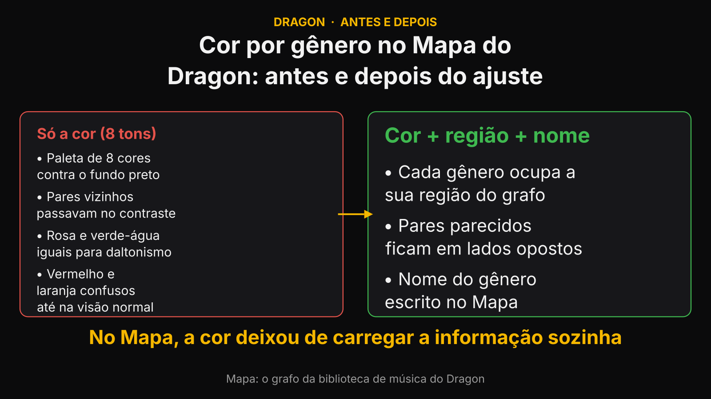
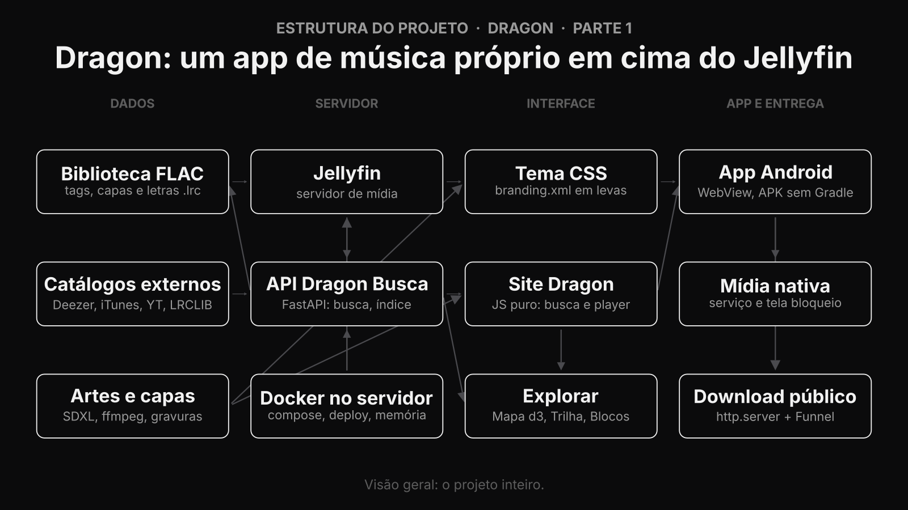

# Dragon: um app de música próprio em cima do Jellyfin

**Projeto:** Dragon · **Data:** 12/11/2026 · **Série:** parte 1

Dragon é a interface de música que montei em cima do Jellyfin do meu servidor de casa. Começou como tema em CSS no `branding.xml`, já que o Jellyfin só aceita CSS no painel de Branding, com 20 melhorias em 4 levas de 5. O Jellyfin 12.1 mistura o layout antigo com componentes React/MUI, e o cabeçalho e o avatar só mudaram com seletores `header.MuiAppBar-root`. Uma linha que cortava a tela vinha de `background-attachment: fixed`, que tirei do tema base, e o item 19, um brilho de carregamento com `!important`, cobria as capas de preto e ficou desligado. Teve também um travamento: o Jellyfin mandava o PNG de fundo de 3200×2139 sem reduzir, baixado e decodificado várias vezes, e troquei por um JPG de 1920 px, o que levou o arquivo de 3,9 MB para 424 KB.\
Em volta disso vieram um site em FastAPI num container, com 28 melhorias (Mapa e Trilha ficam em `partes.js`, Blocos e Montar em `blocos.js`), e um app Android de 17 kB, uma WebView compilada sem Gradle com `aapt2`, `javac`, `d8` e `apksigner`. Na 1.6 a interface passou a ir dentro do APK, com cache de capas de até 200 MB que apaga as menos usadas. Na 1.7 os controles foram para o aviso, a tela de bloqueio e o fone Bluetooth: um script injetado olha `navigator.mediaSession` e o `<audio>` a cada 1 s e só chama `DragonNativo.estado(...)` quando algo muda, e os botões voltam por `__dragonFazer(acao)`. No Mapa, com 429 músicas e 528 artistas na contagem de 04/11 (Rock com 24,0% das músicas, Funk com 17,7%), a paleta de 8 cores confundia rosa e verde-água para daltonismo e vermelho e laranja até para visão normal, então cada gênero ganhou região própria, pares parecidos em lados opostos e o nome escrito.\
Em 09/11 tudo virou um app só de música, com Início, Buscar, Biblioteca e a tela Tocando, publicado com `Busca/publicar-app-novo.sh`, e em 10/11 as funções antigas voltaram numa aba Explorar. Parte da tela Tocando veio de apps Flutter como o Finamp, por exemplo a capa que passa do mini player para a tela cheia com View Transitions. O selo de qualidade usa a taxa média de teoria, $8 \cdot \text{bytes} / (1000 \cdot \text{s})$, que inclui capa e tags embutidas, então é estimativa e ainda não conferi com o servidor. Também falta testar num celular de verdade: o emulador caiu 4 vezes na primeira carga com a guarda local ligada, sem causa confirmada, e o container encostou no limite de 512 MB com a busca parada, com suspeita, ainda não confirmada, de um cache no `app.py`.

---
`#Jellyfin` `#FastAPI` `#Android` `#CSS` `#SelfHosted`
