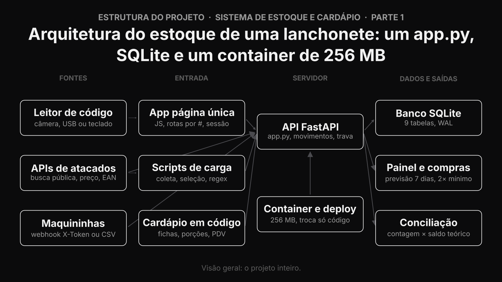

# Arquitetura do estoque de uma lanchonete: um app.py, SQLite e um container de 256 MB

**Projeto:** Sistema de estoque e cardápio · **Data:** 13/11/2026 · **Série:** parte 1

*Onde este post fica na estrutura do projeto:*



Este é o primeiro texto da série sobre o sistema de estoque e cardápio que montei para uma lanchonete com pastelaria e bar. Aqui fica a visão geral: o que o sistema faz, como o código está organizado e onde ele roda. O sistema inteiro roda em um container com limite de 256 MB, que fica em torno de 36 MB em uso. O backend é um `app.py`, o banco é um arquivo SQLite, e código e dados ficam em diretórios separados no servidor.

## Contexto

O sistema cobre o ciclo de estoque de um estabelecimento que vende lanches, pastéis, porções e bebidas:

- cadastro de 1000 produtos, com foto, saldo, mínimo e custo médio;
- bipagem de código de barras para entrada, saída, perda e consulta;
- cardápio de 133 itens em 12 seções, cada um com ficha técnica ligada ao estoque;
- entrada de vendas das maquininhas/PDV;
- conciliação entre o que entrou, o que vendeu e o que foi contado.

## Como está organizado

No repositório:

```text
app/
  app.py        # backend
  static/       # interface
ferramentas/    # catálogo, coleta de preços, montagem da base, publicação
dados/          # preços coletados
```

No servidor, a separação é entre código e estado:

```text
<projeto>/app     # código (substituível)
<projeto>/dados   # banco SQLite + fotos dos produtos
```

O container reaproveita a imagem de outro projeto meu e tem limite de 256 MB. Em uso, fica em torno de 36 MB.

Teoria: o SQLite é uma biblioteca que lê e grava um único arquivo de banco. Não existe um processo de servidor de banco separado, então o banco é só mais um arquivo dentro do diretório de dados, junto com as fotos. Fazer backup é copiar esse arquivo, e a tela de Ajustes tem essa opção. Antes das duas cargas grandes (ampliação do catálogo e instalação do cardápio), deixei uma cópia datada do banco no próprio diretório de dados.

O processo de publicação que respeita essa separação é assunto do próximo texto da série.

## Telas

| Tela | O que faz |
|---|---|
| Painel | valor em estoque, itens no mínimo, vendas e perdas de 7 dias, o que repor e em quantos dias acaba |
| Estoque | 1000 produtos com foto, saldo, mínimo, custo médio; ficha com preços por loja, códigos, movimentos e desfazer |
| Bipar | entrada, saída, perda ou consulta por câmera, leitor USB ou teclado |
| Contagem | inventário bipando item por item; ao fechar, lança a diferença |
| Cardápio | 133 itens no formato do impresso, com ficha técnica, custo, CMV e "dá para fazer" |
| Vendas | importação de CSV da maquininha, webhook, ligação de vendas sem ficha |
| Conciliação | saldo esperado × contagem; desvio % e em R$ por produto |
| Compras | itens no mínimo, quanto comprar e a loja mais barata |
| Ajustes | backup do banco, CSV, chave da integração, tema |

## Como os dados se ligam

### Ficha técnica

Cada item do cardápio tem componentes que apontam para produtos do estoque. Quando uma venda entra, o sistema baixa os insumos pela ficha. Exemplo: um X-Bacon baixa pão de hambúrguer, hambúrguer, queijo, bacon e maionese. O nome do componente que aparece no cardápio fica num campo `componente` da ficha e pode ser editado abrindo o item. Cada item tem um código PDV (faixas como 1001–1090 para tapiocas e 2001–2013 para pastéis), que é a chave usada pelas vendas.

### Entrada de vendas

As vendas chegam por dois caminhos. O primeiro é um webhook:

```http
POST /api/integracao/vendas
X-Token: <chave gerada em Ajustes>

{"vendas": [{"ref": "...", "codigo_pdv": "...", "qtd": 1, "valor": 0, "ts": "..."}]}
```

Uma venda com a mesma `ref` não é lançada duas vezes, então reenviar o mesmo lote não duplica a baixa. O segundo caminho é exportar o relatório da maquininha em CSV e importar na tela Vendas. Vendas cujo código não tem ficha aparecem para serem ligadas a um item.

### Conciliação

Para cada produto, o saldo esperado é:

$$S_{esperado} = S_{inicial} + E - V - S - P$$

onde $E$ são as entradas, $V$ as baixas por venda (via ficha técnica), $S$ as saídas e $P$ as perdas. Esse valor é comparado com a contagem física feita na tela Contagem, e a tela mostra o desvio em porcentagem e em reais por produto. Um desvio grande num insumo indica perda não registrada ou ficha técnica com porção errada.

### Compras

A tela de Compras lista o que está no mínimo e sugere comprar 2× o estoque mínimo, indicando a loja mais barata entre os preços coletados.

## Números

- Container: limite de 256 MB, cerca de 36 MB em uso.
- 1000 produtos, sendo 900 vindos do catálogo de dois atacadistas, em 9 categorias.
- 856 códigos de barras novos e 899 fotos na ampliação.
- Cardápio: 133 itens em 12 seções; 19 insumos novos criados para cobrir as fichas.
- 9 telas.

## Limitações e próximos passos

- O banco começa com saldo zero. Sem a primeira contagem real não há estoque inicial, e a conciliação ainda não tem dado real para comparar.
- A maquininha/PDV real ainda não foi escolhida. Por enquanto a entrada de vendas é pelo CSV.
- As quantidades das fichas são porções-padrão de lanchonete (hambúrguer 100 g, queijo 30 g, massa de pastel 60 g, meia porção = 60% da inteira) e precisam ser conferidas na cozinha. Enquanto isso, o custo, o CMV e a baixa por venda herdam esse erro.
- Estoque mínimo e local de guarda dos produtos novos foram definidos por regra a partir da categoria e precisam de revisão nos itens que mais giram.
- A leitura pela câmera do celular ainda não foi testada.

Os próximos textos tratam do deploy que troca só o código, da bipagem e da coleta de preços.

---
`#Python` `#SQLite` `#Docker` `#ControleDeEstoque` `#SelfHosted`
