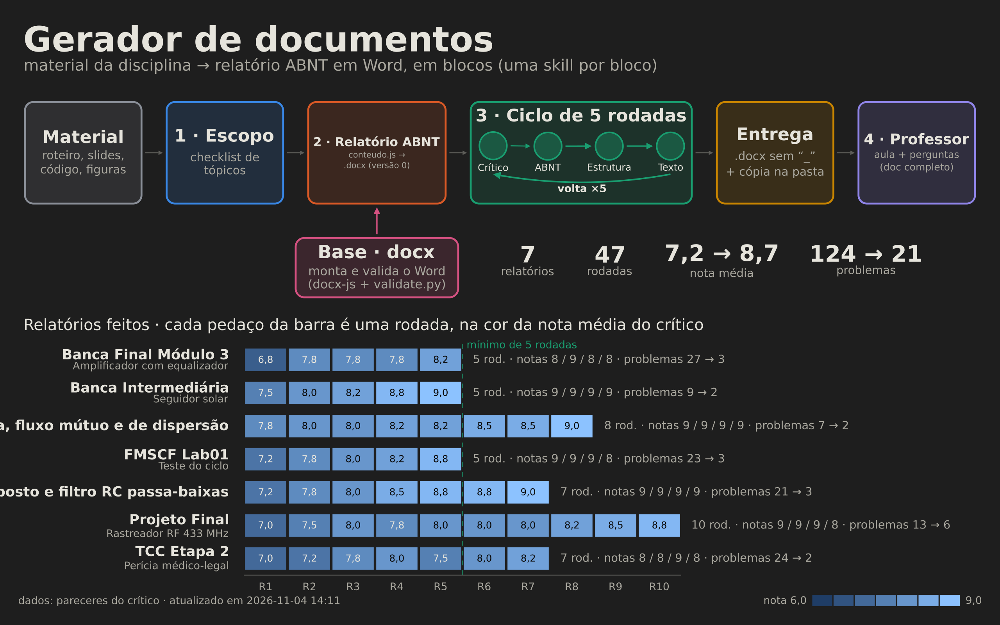
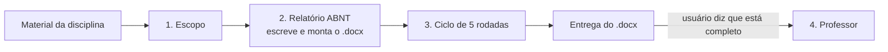

# Arquitetura do gerador: um pipeline de skills do Claude Code com uma tarefa por bloco

**Projeto:** Gerador de documentos com IA · **Data:** 14/11/2026 · **Série:** parte 1

*Onde este post fica na estrutura do projeto:*



*Figura do projeto:*


O Gerador de documentos é um conjunto de skills do Claude Code que transforma o material técnico de uma disciplina (roteiro ou enunciado em PDF, slides, código `.m`/`.py`/`.Rmd`, saídas numéricas `saida*.txt`, figuras e planilhas) em um relatório em Word (.docx) no padrão ABNT. Este texto trata da arquitetura: como o trabalho foi dividido em blocos, o que cada um recebe e entrega, e como o documento atravessa a cadeia. O ciclo de revisão e o bloco de escopo têm posts próprios nesta série.

## Contexto

Em vez de um único agente fazendo tudo, o gerador é uma cadeia de skills especializadas. Cada skill tem uma tarefa só e entrega artefatos em arquivo para o próximo bloco. Para iniciar, peço ao Claude "começa o gerador" e indico onde está o material.

## Como os blocos se ligam



| Bloco | Skill | Responsabilidade | Entrega |
|---|---|---|---|
| 1 | `escopo` | Lê o material e monta o checklist de tópicos obrigatórios e opcionais | `escopo/escopo.md` e `escopo.json` |
| 2 | `relatorio-abnt` | Escreve o `conteudo.js`, gera o .docx ABNT, aplica as críticas e conduz o fluxo | `Relatorio … ABNT.docx` |
| 3a | `critico` | Avalia o conteúdo seção por seção (riqueza, clareza, rigor, linguagem) | `critica/rodada-N/parecer.md` e `.json` |
| 3b | `revisar-estrutura` | Confere o documento renderizado em 12 passos | `revisao-estrutura.md` e páginas marcadas |
| 4 | `professor` | Com o documento fechado, dá uma aula e faz perguntas | `professor/aula.md`, `perguntas.md`, `desempenho.md` |
| base | `docx` | Biblioteca docx-js e validador do arquivo | usada pelos blocos 2 e 3a |

A comunicação entre blocos é feita por arquivos dentro da pasta do relatório. O checklist do escopo, por exemplo, é lido depois pelo crítico para verificar se cada tópico e cada item do roteiro (P1, P2, …) foi tratado.

## O caminho de um documento

1. **Escopo.** A skill estima o tipo de documento (laboratório, projeto, pesquisa, TCC ou estágio) e sugere tópicos. O usuário confirma o checklist. Fundamentos teóricos sempre entram.
2. **Versão 0.** A `relatorio-abnt` cria a pasta do relatório, gera o `conteudo.js` já com os títulos das seções escolhidas, na ordem certa, e a pasta `figuras/`. Depois escreve o conteúdo e constrói o .docx.
3. **Ciclo de 5 rodadas.** Crítico, `relatorio-abnt`, `revisar-estrutura` e revisão de texto, nessa ordem, 5 vezes, mesmo que o documento pareça pronto antes. O usuário pode pedir mais: houve 10 rodadas num projeto de RF 433 MHz e 7 no TCC.
4. **Entrega.** Construção final, resumo com a evolução das notas e cópia do .docx para a pasta de saída, com nome sem `_`.
5. **Professor.** Só depois que o usuário confirma que o documento está completo.

Cada rodada termina com uma linha de status neste formato:

```
Rodada N/5 – notas (riqueza, clareza, rigor, linguagem) · comentários aplicados X/Y · estrutura: ❌ 0, ⚠️ k
```

## Detalhes

### Conteúdo separado da formatação

A formatação ABNT (capa, folha de rosto, sumário, numeração, legendas, equações, referências) fica fixa dentro da `relatorio-abnt`, no `scripts/gerar.js`. A cada relatório só muda o `conteudo.js`. O build é um comando só, `construir.sh`, que:

- gera o Word com a biblioteca docx-js;
- abre o arquivo no LibreOffice, mede em que página cai cada título e refaz o sumário até os números baterem;
- valida o arquivo;
- roda a revisão de texto e a revisão de estrutura;
- monta uma prévia com todas as páginas.

O sumário é o ponto em que o gerador depende da renderização: o número de página só existe depois que o documento é paginado, por isso o build itera entre gerar e medir.

### Word gerado direto, sem conversão

O .docx sai direto do docx-js, sem pandoc e sem converter de LaTeX ou Markdown. Fórmula no meio do texto vira texto formatado; fórmula em destaque vira imagem com número (n) à direita. O editor de equações do Word não é usado. Termos técnicos e siglas entram num vocabulário para o corretor (LanguageTool) não marcá-los como erro.

### Validação e caminho do validador

Todo .docx gerado passa pelo `validate.py` da skill docx, inclusive a cópia com comentários que o crítico produz. Como essa skill é atualizada pela Anthropic, a pasta dela muda de nome. Por isso os scripts não guardam um caminho fixo e procuram o validador pelo padrão:

```
*/docx/scripts/office/validate.py
```

### Regras transversais

- Nada é inventado: dado que não existe no material vira `[falta: …]` no texto.
- Depois de criar ou alterar qualquer .docx, a `revisar-estrutura` roda os 12 passos (página e margens A4 3/3/2/2 cm, pré e pós-textuais pela NBR 14724, quebras, títulos e sumário, parágrafos, tabelas, fórmulas, figuras, fontes, citações pela NBR 6023/10520, consistência, compatibilidade com o Word).
- Ao mudar o gerador, um teste de regressão compara o resultado com um relatório de laboratório já aprovado (Lab01).
- Nomes de arquivos novos sem `_`.

### O professor é somente leitura

O último bloco não pode alterar o documento. Ao começar, ele guarda um hash do .docx e do `conteudo.js` (`scripts/trava.py`) e confere a trava no fim. Erro encontrado durante a aula vai para `professor/observacoes.md`; para corrigir, o gerador é reaberto. Se houver `[falta: …]`, TODO ou ciclo incompleto, ele mostra antes de começar. A aula cobre conceitos, equações com símbolos e unidades, método, resultados e limitações, cada ponto citando a seção do documento, e depois vêm 12 perguntas por padrão, corrigidas uma a uma (✅ / ◐ / ❌).

### Manutenção pelas notas

Cada bloco tem uma nota no Obsidian com a seção "Alterações que eu quero". Escrevo a mudança como `- [ ] …`, peço "aplica as alterações do Obsidian no gerador", e o Claude altera a skill, marca o item como `- [x]` e registra no Histórico o que mudou e quando.

## Números

- 5 skills próprias + 1 skill base (docx).
- 5 etapas no caminho de um documento.
- 5 rodadas mínimas no ciclo (10 e 7 quando pedidas).
- 12 passos na revisão de estrutura.
- 5 tipos de documento reconhecidos pelo escopo.
- 12 perguntas por padrão no professor.

## Limitações e próximos passos

- Tabela que passa de uma página não recebe "(continua)"; hoje a tabela é dividida em duas.
- As medidas de página vêm do LibreOffice. Em quebras muito justas, ainda vale conferir 2 ou 3 páginas no próprio Word.
- O escopo começa por busca de palavras-chave (`analisar.py`), que precisa ser conferida por leitura do roteiro. Isso é tratado no post sobre a skill escopo.

---
`#ClaudeCode` `#LLMAgents` `#DocumentAutomation` `#Python` `#JavaScript`
