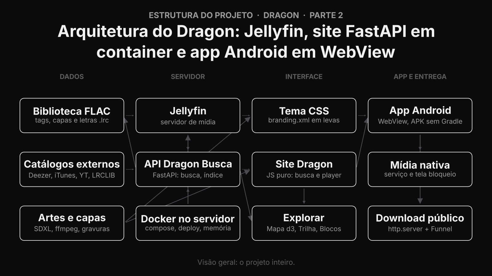
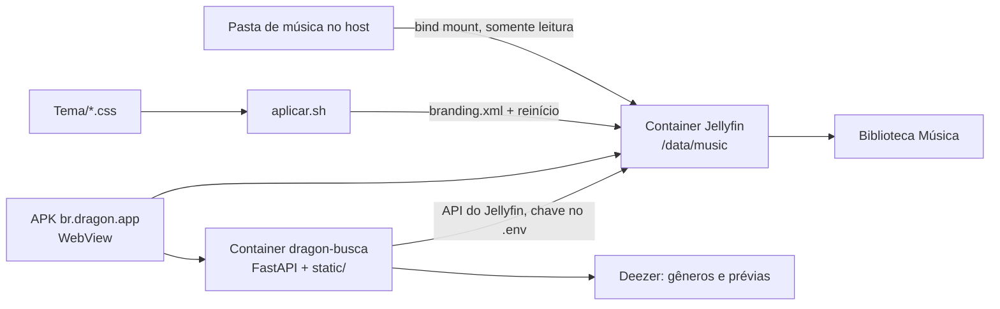

# Arquitetura do Dragon: Jellyfin, site FastAPI em container e app Android em WebView

**Projeto:** Dragon · **Data:** 15/11/2026 · **Série:** parte 2

*Onde este post fica na estrutura do projeto:*



O Dragon é a minha interface de música em cima do Jellyfin. Neste post descrevo só a arquitetura: quais processos existem, onde cada um roda e por onde eles conversam. São três peças. A primeira é o Jellyfin num container, com a biblioteca montada somente leitura e o tema injetado pelo `branding.xml`. A segunda é um segundo container com um site em FastAPI que usa a API do Jellyfin. A terceira é um APK Android que abre as duas interfaces numa WebView.

## Visão geral



## 1. Jellyfin e a biblioteca somente leitura

O container do Jellyfin, do jeito que estava, só tinha volumes de filmes e séries. A pasta de música do host não aparecia lá dentro. Enquanto isso não estava resolvido, a biblioteca apontava para uma cópia provisória em `/config/musica-temporaria`.

A solução foi o script `montar-musica.sh`. Ele liga a pasta do host ao container como `/data/music`, somente leitura. A primeira versão editou o `docker-compose.yml`, cortou o bloco do volume de séries e deixou o compose quebrado. A segunda versão sempre parte do backup `docker-compose.yml.bak-2026-11-04` e roda `docker compose config` para validar o arquivo antes de subir. Depois da montagem, troquei o caminho da biblioteca para `/data/music`, copiei as letras `.lrc` e apaguei a cópia provisória.

Ao recriar o container fora do painel que o gerencia, tive outro problema. Sem as variáveis de usuário, ele roda como o usuário 911 e troca o dono de `/config`. Por isso o comando passa as variáveis explicitamente:

```bash
sudo env PUID=1000 PGID=1000 TZ=America/Sao_Paulo docker compose up -d
```

O monitoramento em tempo real do Jellyfin não detectou os arquivos novos que chegavam à pasta. Durante a carga inicial da biblioteca, a varredura ficou agendada ao iniciar e a cada 1 h. Depois voltou para 12 h, e o script de envio passou a pedir uma varredura quando chega música nova.

## 2. Tema pelo branding.xml

O Jellyfin só aceita CSS no Branding, sem JavaScript. O tema base e as levas de melhorias são arquivos `Tema/*.css`. O `aplicar.sh` concatena esses arquivos, grava o resultado no `branding.xml` (CustomCss + splashscreen) e reinicia o Jellyfin, o que leva cerca de 45 s. Os detalhes de seletores e levas estão nos outros posts da série. Aqui importa só que o tema é estado do servidor, não do cliente.

## 3. Segundo container: dragon-busca

O que o CSS não alcança fica num site separado, que roda no container `dragon-busca`:

```
Busca/
├── app.py            # servidor FastAPI
└── static/
    ├── index.html
    ├── partes.js     # Mapa e Trilha
    ├── blocos.js     # Blocos e Montar
    ├── acabamento.css/.js
    └── submenus.css/.js
```

O `app.py` conversa com:

- a API do Jellyfin, autenticada por uma chave guardada no `.env` do container. Por ela o site cria playlists, envia capas (`POST /Items/{id}/Images/Primary`) e avisa o Jellyfin quando uma faixa entra na biblioteca. Assim a faixa aparece sem esperar a varredura;
- o Deezer, de onde vieram os gêneros dos 528 artistas usados no Mapa e as prévias de 30 s da Trilha;
- o `mutagen`, para as tags dos arquivos.

As duas interfaces se ligam pelo menu ☰ do Jellyfin, que ganhou links para o site. Esses links são abertos na mesma aba. O script `menu-jellyfin.sh` aplica essa mudança e precisa ser rodado de novo sempre que o Jellyfin é atualizado.

### Deploy sem rebuild

No dia 04/11, construir a imagem do site no próprio servidor esgotou a RAM: swap em 100%, carga 54, SSH e Jellyfin travados por cerca de 10 min. Desde então, mudança só de código entra assim:

```bash
docker cp app.py dragon-busca:/...
docker cp static dragon-busca:/...
docker restart dragon-busca
```

Reconstruir a imagem (`atualizar.sh`) ficou reservado para atualizar dependências, com o servidor folgado: sem varredura do Jellyfin e sem envio de músicas.

## 4. App Android: WebView de 17 kB

O APK (`br.dragon.app`) é uma WebView que abre a interface web do Jellyfin. Os links do menu levam ao site dentro do próprio app. O build não usa Gradle:

```
aapt2 → javac → d8 → apksigner
```

O keystore de assinatura fica fora do repositório. Sem ele o celular recusa a atualização.

Detalhes que fazem o app funcionar:

- **Rede:** o app tenta primeiro o endereço da rede de casa. Se não houver resposta em 1,5 s, ele vai pelo Tailscale. Os endereços escritos nas páginas são trocados na hora, e se a rede muda com o app aberto, ele escolhe de novo e recarrega.
- **Ponte JS ↔ Java:** `Principal.PONTE_JS` é injetado em toda página. A cada 1 s ele lê `navigator.mediaSession` e o `<audio>` e chama `DragonNativo.estado(...)` só quando algo mudou. Os botões do aviso voltam para a página por `__dragonFazer(acao)`. Na versão 1.7, isso alimenta a sessão de mídia: o aviso vira player e os controles chegam à tela de bloqueio e ao fone Bluetooth.
- **Segundo plano:** um serviço em primeiro plano, com o aviso "Dragon", mantém a música tocando com a tela apagada.

### Versão 1.6: cache no celular

Na 1.6, o `compilar.sh` passou a copiar `Busca/static` para dentro do APK, e `Guarda.java` controla o cache:

- a interface do site abre direto do APK e se atualiza em segundo plano. O que mudou no servidor aparece na abertura seguinte;
- arquivos do Jellyfin com versão no nome ficam guardados para sempre, e `index.html` e `config.json` são conferidos a cada abertura;
- as capas ficam num cache de até 200 MB, que apaga as menos usadas;
- ao atualizar o app, as páginas guardadas são apagadas e as capas continuam.

No emulador (Android 15), a rolagem ficou em 60 fps depois que as capas estavam em cache.

## Números

| Item | Valor |
|---|---|
| APK | 17 kB |
| Reinício do Jellyfin ao aplicar o tema | ~45 s |
| Limite de memória do `dragon-busca` | 512 MB |
| Travamento no build da imagem | ~10 min (swap 100%, carga 54) |
| Timeout para trocar de rede no app | 1,5 s |
| Cache de capas no celular | até 200 MB |

## Limitações e próximos passos

- Em 05/11 o `dragon-busca` encostou no limite de 512 MB, o swap do servidor chegou a 100% e a busca parou de responder. O reinício libera a memória. Ainda não identifiquei o que segura a memória dentro do `app.py`.
- No emulador, o app caiu 4 vezes na primeira carga do site, sempre com o cache ligado. Sem o cache ele não caiu, e o Chrome do emulador também não. Depois, com o cache ligado, passou duas vezes sem cair. A causa não está confirmada.
- Os testes de layout foram no Chrome headless a 384 px e no emulador. Falta testar num celular de verdade.
- Na versão 2.0 (09/11), a interface foi unificada num app só de música, servido pelo site. A versão antiga continua acessível em `/antigo/`.

---
`#Jellyfin` `#FastAPI` `#Docker` `#AndroidDev` `#SelfHosted`
