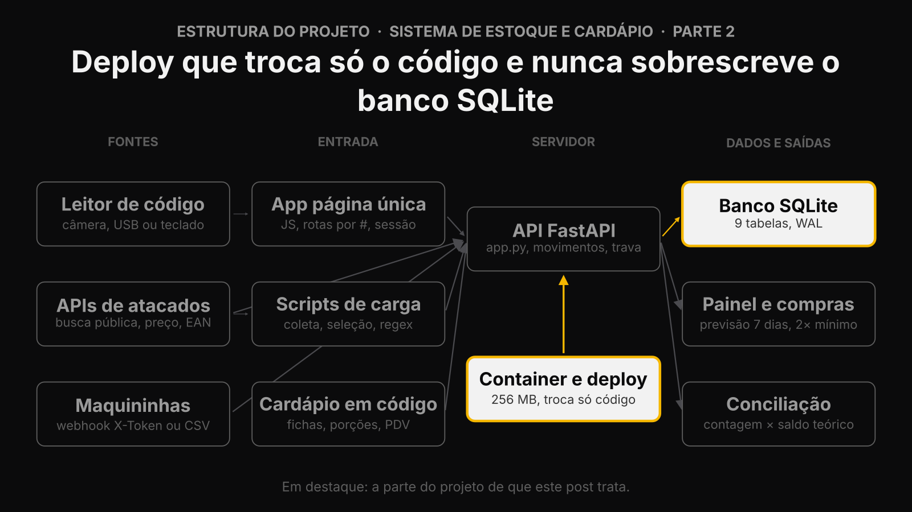

# Deploy que troca só o código e nunca sobrescreve o banco SQLite

**Projeto:** Sistema de estoque e cardápio · **Data:** 16/11/2026 · **Série:** parte 2

*Onde este post fica na estrutura do projeto:*



No sistema de estoque e cardápio que fiz para uma lanchonete, separei o que pode ser substituído a qualquer momento (o código) do que não pode (o banco SQLite de produção). O script de publicação troca só o código no servidor. Mudanças grandes de dados seguem outro caminho, e antes de cada uma delas fica uma cópia datada do banco.

## Contexto

O app roda em um container no servidor de casa. O estado inteiro do sistema está em um arquivo SQLite: 1000 produtos, saldos, movimentos de entrada, saída e perda, contagens, fichas técnicas do cardápio e vendas importadas das maquininhas. As fotos dos produtos ficam junto com o banco.

Nesse arranjo, um deploy que copiasse a pasta do projeto inteira por cima da do servidor apagaria o estoque real com a cópia de desenvolvimento. Por isso o deploy e os dados ficaram separados.

## Como funciona

No servidor há duas pastas:

| Pasta | Conteúdo | Quem altera |
|-------|----------|-------------|
| código | `app.py` e `static/` | `ferramentas/publicar.sh` |
| dados | arquivo SQLite, fotos, cópias de segurança | o próprio app e os scripts de dados |

No repositório a separação é a mesma: `app/` tem o código, `ferramentas/` tem os scripts de catálogo, coleta de preços, montagem da base e publicação, e `dados/` tem os preços coletados.

Publicar uma mudança de código é um comando só:

```bash
ferramentas/publicar.sh
```

Ele substitui apenas o código. O banco do servidor nunca é sobrescrito, então posso publicar quantas vezes precisar sem pensar no que já foi registrado.

## Mudanças de dados por outro caminho

O que altera o conteúdo do banco não vai pelo deploy. Há scripts próprios para isso.

A ampliação do catálogo roda em três etapas, e a última envia o resultado ao servidor:

```bash
ferramentas/ampliar-coleta.py
ferramentas/ampliar-selecao.py   # vagas por categoria na constante VAGAS
ferramentas/ampliar-instalar.py fotos | pacote | enviar
```

O script do cardápio recebe o endereço do app e instala os itens por ele. Ele só atualiza, não duplica: rodar de novo depois de editar uma quantidade na ficha técnica ajusta o item existente em vez de criar outro.

## Cópia datada antes de cada mudança grande

Antes de cada operação que mexeu em muitos registros, tirei uma cópia do arquivo SQLite dentro da pasta de dados, com data e hora no nome:

1. **Antes da ampliação do catálogo.** O nome da cópia termina em `20261110131016` (AAAAMMDDhhmmss). Nessa etapa entraram 900 produtos novos, com 856 códigos de barras e 899 fotos.
2. **Antes da troca do cardápio.** Saíram os 22 itens de teste do cardápio antigo e entraram 133 itens em 12 seções, cada um com componentes ligados ao estoque.

Nos dois casos, se o resultado viesse errado (categoria trocada, código duplicado, ficha técnica apontando para o insumo errado), a volta era restaurar o arquivo daquele momento.

Na troca do cardápio, remover os 22 itens de teste não apagou o histórico de vendas deles: as vendas continuam no banco.

## Backup no dia a dia

A tela Ajustes tem backup do banco e exportação em CSV. Isso cobre o uso normal, sem eu precisar entrar no servidor.

## Números

- 1000 produtos no banco depois da ampliação (100 antes, 900 novos)
- 133 itens de cardápio instalados por script que não duplica
- 22 itens de teste removidos com o histórico de vendas mantido
- 2 cópias datadas do banco, uma antes de cada mudança grande de dados
- 1 comando para publicar código

## Limitações e próximos passos

- **As cópias ficam no mesmo lugar que o banco.** Estão na mesma pasta de dados, no mesmo servidor. Protegem contra um script de dados errado, não contra perda do disco. Falta mandar uma cópia para fora da máquina.
- **A cópia antes de cada mudança grande foi feita por mim.** A fonte do projeto não mostra um passo automático que faça isso antes de cada script de dados.
- **O banco ainda não tem dados de operação real.** O estoque começa com saldo zero e a primeira contagem real está pendente. As cópias vão passar a importar de verdade quando houver movimento.
- **Restauração.** Ainda não registrei um teste de restauração a partir de uma dessas cópias. É o próximo item para o backup deixar de ser só um arquivo guardado.

---
`#SQLite` `#Deploy` `#Backup` `#Python` `#DevOps`
