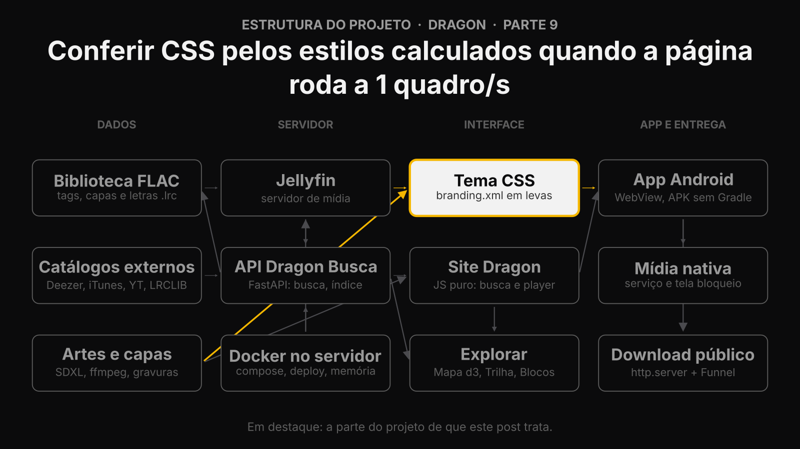

# Conferir CSS pelos estilos calculados quando a página roda a 1 quadro/s

**Projeto:** Dragon · **Data:** 17/11/2026 · **Série:** parte 9

*Onde este post fica na estrutura do projeto:*

As levas 3 e 4 do Dragon, o tema só de CSS que gravei no `branding.xml` do Jellyfin, cobrem os itens 11 a 20 (`leva-3.css` e `leva-4.css`) e são quase só animação: barra do player, capa que pulsa, letra sincronizada, fila em cartões, layout de celular, foco para TV. Na aba controlada pelo agente (Claude), o Jellyfin rodava a ~1 quadro/s. Medi na mesma aba: ~1 com o tema, ~1 sem o tema e 60 numa página simples do mesmo servidor. Isso tira o tema da lista e mostra que a aba e o servidor desenham normalmente. O problema está nas páginas do Jellyfin naquela aba, e a causa exata eu não identifiquei. Pela teoria, $\Delta t = 1/f$: a 60 quadros/s são uns 16,7 ms entre quadros, a 1 quadro/s é 1 s. Uma transição de algumas centenas de milissegundos cabe inteira entre dois quadros e nunca aparece, e o que depende de `requestAnimationFrame` anda um passo por segundo. Para piorar, o print do Chrome falhava até na página simples.\
Aí conferi pelos estilos calculados, o valor final que o navegador resolve para cada propriedade depois da cascata, da especificidade, da herança e do `!important`. É o que `getComputedStyle` devolve e o que a aba Computed das DevTools mostra. Para um tema só de CSS, isso responde se o seletor achou o elemento, se a regra ganhou da do Jellyfin e se o valor final (cor, raio, tamanho, `outline`) é o esperado, sem depender dos quadros. O seletor pesa no 12.1, que mistura o layout antigo com React/MUI. Nas levas anteriores, o cabeçalho e o avatar só mudaram com `header.MuiAppBar-root`. A fila do item 15 não tem título no 12.1, então o "A seguir" passou a ser criado pelo CSS e as faixas foram para cartões. Depois disso, o item foi conferido. O item 18 deu falso negativo: durante uma transição, o estilo calculado devolve o valor interpolado daquele instante, e eu li cedo demais. Repeti depois que a transição terminou e passou, mas a 1 quadro/s acertar o momento da leitura dá mais trabalho.\
Ficou de fora o que só se vê na tela. O destaque da linha atual da letra (item 14) foi conferido, mas a rolagem automática até ela não aconteceu, porque a rolagem animada do Jellyfin depende dos quadros. O engrossar da barra no hover (item 11) ficou sem teste. O celular foi simulado a 400 px e o foco para TV também foi simulado, sem aparelho. O brilho de carregamento (item 19) está desligado. Não sei se o ~1 quadro/s acontece fora da aba controlada, e na nota do projeto continua pendente ver com os próprios olhos se o Dragon anda liso e se a letra rola sozinha.

---
`#CSS` `#Jellyfin` `#FrontEnd` `#WebTesting` `#DevTools`
