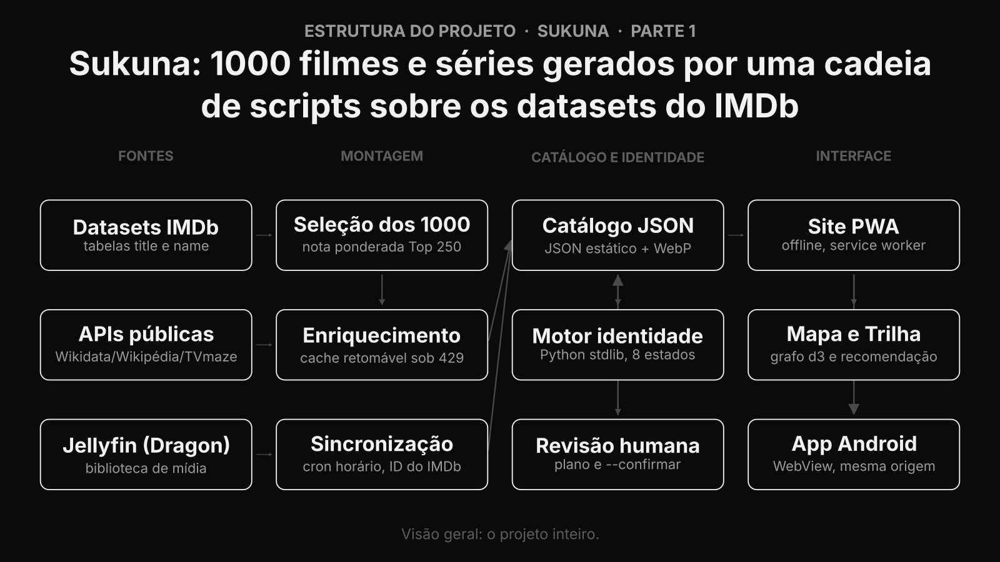

# Sukuna: 1000 filmes e séries gerados por uma cadeia de scripts sobre os datasets do IMDb

**Projeto:** Sukuna · **Data:** 18/11/2026 · **Série:** parte 1

*Onde este post fica na estrutura do projeto:*

O Sukuna é meu catálogo pessoal de 1000 títulos, cada um com cartaz, nota e resumo, numa interface web instalável. Não tem banco nem API. É uma cadeia linear de scripts Python em que cada um lê o que o anterior gravou em `dados/`, e no fim sai JSON estático que o navegador lê direto. A primeira versão, de 05/11/2026, tinha só os 51 filmes do Sight and Sound 2022 do BFI. No dia seguinte vieram as 50 séries de The 100 Greatest TV Shows of All Time (Rolling Stone, 2022). Para chegar a 1000, o `selecionar-1000.py` cruza `title.basics`, `title.ratings`, `title.crew` e `name.basics` dos datasets públicos do IMDb e grava `dados/selecao.json`. A conta fecha em $51 + 599 = 650$ filmes e $50 + 300 = 350$ séries. Uma lista `FORCAR` no mesmo script garante Jujutsu Kaisen, Jujutsu Kaisen 0, Bleach e clássicos brasileiros, independente do corte por nota.\
Em seguida o `enriquecer-1000.py` busca resumo, sinopse e imagens no Wikidata, na Wikipédia (pt e en) e no TVmaze. Ele salva as imagens em WebP em `static/mini/novos/` e grava `dados/novos.json`, com um cache em `dados/cache-novos.json` que permite parar e rodar de novo. O que faltou eu fechei com ajustes. O `ajustar-novos.py` aplica os títulos no Brasil e correções fixadas pelo ID do IMDb. Foi ali que corrigi 9 títulos que tinham ficado com o texto literal "título", como Porco Rosso, Waking Life e True Blood. Já o `cartazes-faltando.py` e o `cartazes-imdb.py` deram o cartaz do IMDb a 612 títulos e o fundo da TVmaze a 17 séries. Por último, o `notas-imdb.py` grava nota e votos de todos em `dados/notas-imdb.json`.\
No navegador, `app.js`, `mapa.js` e `estilo.css` montam a grade com filtros, as fichas, a busca e o grafo por gênero e direção. O d3 7.9.0 fica guardado em `static/d3.min.js` para funcionar sem internet, e `manifest.json` com `sw.js` deixam o site instalável e offline. O `publicar.sh` copia a pasta por tar para o servidor, onde um container com `python http.server` (64 MB, pasta montada só leitura) serve os arquivos sem reiniciar. O problema de ser tudo estático é que o navegador só pega a versão nova quando eu troco `CACHE` no `sw.js`, e já fui de `sukuna-v6` a `sukuna-v14`. As notas ficam congeladas no dia em que o script rodou. As 104 séries e os filmes do IMDb ainda usam o cartaz borrado no lugar da foto de cena. E o casamento por título deixa erros. Para auditar isso escrevi um motor separado de resolução de identidade, que não altera o catálogo.

---
`#Python` `#DataPipeline` `#IMDb` `#PWA` `#WebDev`
