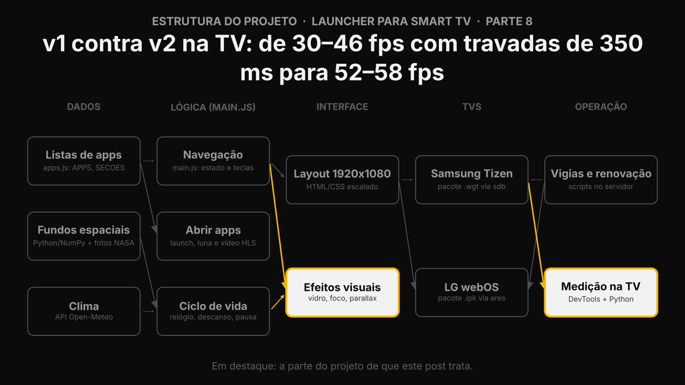

# v1 contra v2 na TV: de 30–46 fps com travadas de 350 ms para 52–58 fps

**Projeto:** Launcher para Smart TV · **Data:** 19/11/2026 · **Série:** parte 8

*Onde este post fica na estrutura do projeto:*

Medi na própria TV a diferença entre a v1 e a v2 do launcher que fiz para uma TV Samsung de 2024 com Tizen 8.0. É um app web em HTML, CSS e JavaScript, instalado pelo modo desenvolvedor. A v1 tinha menu lateral de vidro, ícones oficiais, parallax, brilho no foco e fundos do sistema solar trocando. Na prévia do PC parecia fluida, mas na TV travava, principalmente ao abrir o menu. Deixei a v1 em backup como referência e medi tudo no aparelho. O `sdb shell 0 debug` mostra a porta de depuração do app, e o `sdb forward tcp:P tcp:P` leva essa porta para o notebook. Aí rodo `medir-fps.py` enquanto navego, e uso `por-tecla.py` para o tempo de cada tecla.\
Na v1, o Início dava 46 fps com travadas de até 133 ms. Menu e grade ficavam em 30–37 fps com travadas de até 350 ms, e uma tecla levava até 233 ms para responder. Na v2 otimizada ficou 58 fps no Início, 52 fps em menu e grade e 17–50 ms por tecla. Pela teoria, a 60 Hz cada quadro tem $1000/60 \approx 16{,}7$ ms, e uma travada de $t$ ms perde cerca de $t/16{,}7$ quadros. Então 133 ms são uns 8 quadros e 350 ms uns 21, que já é um congelamento visível. Os 233 ms da tecla dão uns 14 quadros entre apertar e ver a reação, contra 1 a 3 na v2. Por isso a média de 46 fps do Início não contava a história: os picos é que se sentiam no controle.\
As mudanças tiram layout e repintura do caminho da navegação. O menu animava `width` e virou dois painéis que só mudam `opacity`. As duas telas ficam prontas e só trocam opacidade, e o anel de foco foi para uma camada própria com `will-change: opacity`. Dos 5 fundos compostos ao mesmo tempo, só o ativo fica visível. A animação contínua saiu, e o fundo só se mexe quando o foco muda. O desfoque começa desligado, com a opção Efeito de vidro no menu. Na teoria do pipeline do navegador, animar `width` obriga a recalcular layout e repintar a cada quadro, enquanto `opacity` numa camada própria pode ser resolvida só na composição. Só que a comparação é entre versões inteiras, já que a v2 também mudou o layout (3 cartões no Início e grade 6×2). Ainda não separei o ganho de cada item: o `ablacao.py` desliga um efeito por vez, mas esses resultados não estão registrados. Também falta medir a v2 com o vidro ligado, e menu e grade seguem abaixo de 60 fps. Além disso, só tenho faixas e máximos, sem a distribuição dos tempos de quadro.

---
`#WebPerformance` `#Tizen` `#JavaScript` `#CSS` `#SmartTV`
