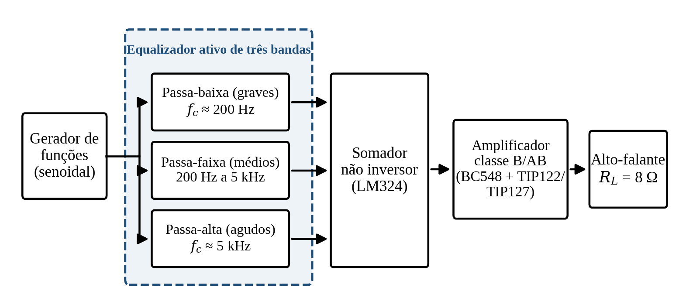

# Arquitetura de um equalizador de três bandas com somador e push-pull classe B/AB

**Projeto:** Amplificador classe AB com equalizador de três bandas (banca) · **Data:** 20/11/2026 · **Série:** parte 1

*Onde este post fica na estrutura do projeto:*

*Figura do projeto:*

No grupo, projetamos, simulamos e montamos uma cadeia de áudio com três blocos em série: um equalizador ativo de três bandas com LM324, um somador não inversor e um push-pull classe B/AB com Darlington TIP122/TIP127 ligado a um alto-falante de 8 Ω. Cada bloco foi calculado, simulado no Multisim e montado em protoboard. Os cruzamentos ficaram em 200 Hz e 5 kHz, com redes RC de primeira ordem ($f_c = 1/2\pi RC$, teoria clássica). Fixamos $C = 100$ nF e calculamos $R \approx 7958$ Ω para 200 Hz e $R \approx 318$ Ω para 5 kHz (corte resultante de 5,005 kHz). A saída de cada rede vai para a entrada não inversora de um AmpOp do LM324 com $R_f = R_g = 1$ kΩ, ganho $A_f = 2$ (≈ 6,02 dB). Aí o passa-faixa vira a cascata de um passa-alta de 200 Hz com um passa-baixa de 5 kHz, com $f_0 = \sqrt{f_L f_H} \approx 1$ kHz, $Q \approx 0{,}21$ e ganho 4, porque são dois estágios de ganho 2.\
Esse ganho 4 é corrigido no somador. Pelo teorema de Millman, $V_+$ é a média das bandas ponderada pelas condutâncias, incluindo a de $R_{19}$ para a terra, e $V_o = (1 + R_{17}/R_{16})V_+$ com $R_{16} = R_{17} = 1$ kΩ. Com 4 kΩ para graves e agudos, 8 kΩ para médios e $R_{19} = 2{,}6$ kΩ, a soma das condutâncias dá cerca de 1,0096 mS e as três bandas chegam com ganho ≈ 0,99 (−0,08 dB). O exato seria 2,67 kΩ, mas o erro fica abaixo de 1 %. O somador não inversor mantém a fase; em troca, mexer em um resistor de entrada muda o peso das três bandas. Para a resposta total valer como produto dos blocos, seguimos $Z_{in} \geq 10\,Z_{out}$: as redes RC veem entradas de AmpOp de impedância muito alta, e a saída realimentada do somador alimenta o amplificador, cuja entrada simulada é 1,07 kΩ sem excitador e 24,5 kΩ com o BC548.\
Na simulação, os cortes deram 199,96 Hz e 5,007 kHz, o passa-faixa teve 11,70 dB em 1 kHz e o traçador de Bode da entrada até a saída do somador mostrou ganho entre −0,17 e +0,24 dB de 20 Hz a 20 kHz, com leve elevação perto de 1 kHz e queda acima de 10 kHz, vindas da diferença de fase entre bandas vizinhas nos cruzamentos. O problema é que essa resposta plana só foi vista no simulador: na bancada ensaiamos cada filtro separado, em poucas frequências, sem varrer o conjunto. A versão com excitador também precisa ser redimensionada, porque o BC548 opera com $V_{CE} \approx 0{,}5$ V em simulação e a saída ceifa com cerca de 0,2 V de pico na entrada.

---
`#EletronicaAnalogica` `#FiltrosAtivos` `#AmplificadorOperacional` `#AudioEngineering` `#Multisim`
