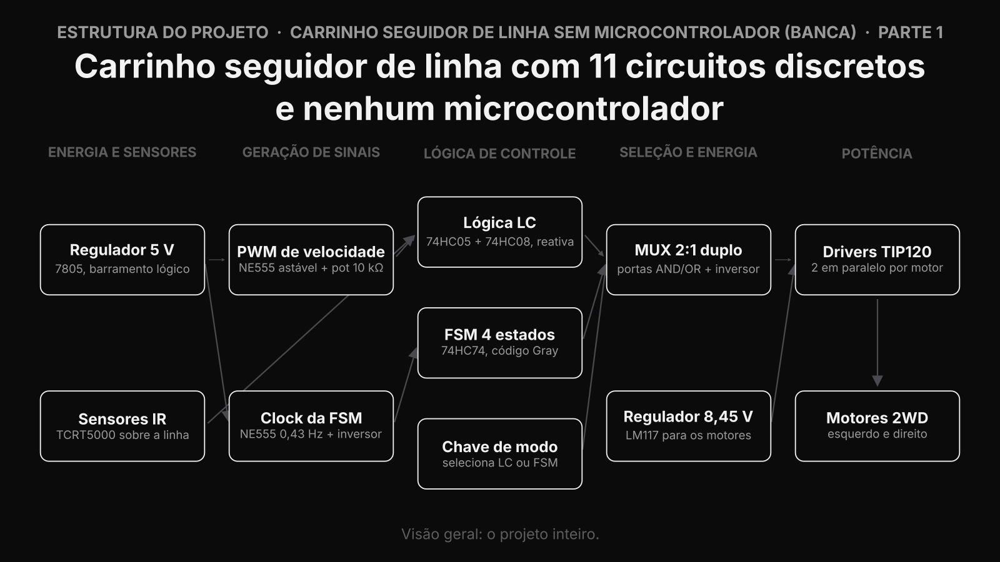

# Carrinho seguidor de linha com 11 circuitos discretos e nenhum microcontrolador

**Projeto:** Carrinho seguidor de linha sem microcontrolador (banca) · **Data:** 21/11/2026 · **Série:** parte 1

*Onde este post fica na estrutura do projeto:*

Em grupo, construímos um carrinho seguidor de linha só com componentes analógicos e CIs de pequena escala de integração (74HC, NE555, reguladores lineares, Darlington TIP120), sem microcontrolador. São 11 circuitos, feitos em duas etapas. Na primeira (circuitos 1 a 6) ficaram o LM117 para o barramento dos motores, o 7805 para os 5 V da lógica, os LEDs indicadores, um NE555 astável fazendo o PWM, a lógica combinacional com 74HC05 e 74HC08 e os drivers, com dois TIP120 em paralelo por motor, resistores de emissor e diodo 1N4007 de roda livre. Os TCRT5000 dão nível alto sobre a linha escura, e cada motor gira quando o seu sensor não a vê: $MELC = \overline{SE}\cdot PWM$ e $MDLC = \overline{SD}\cdot PWM$. O problema é que a saída depende só da entrada atual, então o carrinho não consegue executar uma sequência planejada.\
Na segunda etapa (circuitos 7 a 11) entrou memória. Um segundo NE555 astável faz o clock com Ra = 10 Ω, Rb = 76,7 kΩ e C = 22 µF, o que dá $T \approx 2{,}34$ s e $f \approx 0{,}43$ Hz, com duty perto de 50 %. Dois flip-flops D do 74HC74 guardam o estado $(Q_1, Q_2)$ em código Gray, com $D_1 = Q_2$ e $D_2 = \overline{Q_1}$, e a sequência 00 → 01 → 11 → 10 → 00 fecha sem estados órfãos. As saídas são de Moore, $MEFSM = \overline{Q_1} + \overline{Q_2}$ e $MDFSM = Q_1 + Q_2$: giro à direita em 00, avanço em 01 e 10, giro à esquerda em 11. A chave LC/FSM tem pull-down de 10 kΩ, e o reset é um botão com pull-up de 1 kΩ ligado ao CLR dos flip-flops e ao reset do NE555 do clock. Para escolher o que vai aos drivers, cada canal segue $Y = \overline{S}\cdot D_0 + S\cdot D_1$; para os dois motores foram 4 AND, 2 OR e 1 inversor tirados do 74HC08, 74HC32 e 74HC05 que já estavam na placa, sem 74HC157.\
Simulamos no NI Multisim 14 em três níveis (bloco isolado, blocos aos pares e sistema completo; na primeira etapa foram `Lógica_Combinacional.ms14`, `PWM_LC.ms14` e `Thanos.ms14`) e montamos numa protoboard de 830 pontos, num chassi 2WD com duas 18650 em série (8,4 V). Na pista, cada manobra da FSM durou cerca de 2,3 s, e trocamos de modo com o carrinho andando. Dois ajustes só apareceram nos testes: o primeiro ciclo depois do reset durava metade do previsto, resolvido com um inversor 74HC05 na linha de clock, e o resistor de base dos TIP120 caiu de 1,5 kΩ para 1 kΩ porque não dava corrente com o carrinho carregado. Ficaram a FSM em malha aberta, que roda a mesma sequência em qualquer pista, e o reset só manual. Um capacitor em paralelo com o botão daria reset na energização, mas isso ficou só calculado.

---
`#DigitalLogic` `#FiniteStateMachine` `#NE555` `#Multisim` `#EletronicaDigital`
