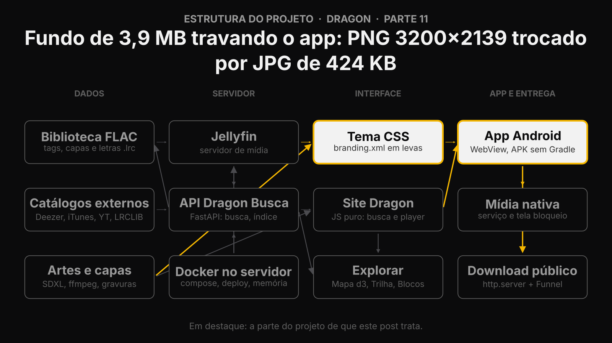

# Fundo de 3,9 MB travando o app: PNG 3200×2139 trocado por JPG de 424 KB

**Projeto:** Dragon · **Data:** 22/11/2026 · **Série:** parte 11

*Onde este post fica na estrutura do projeto:*

O app Android do Dragon travava, e uma das causas estava no tema. O Dragon é o meu app de música sobre um servidor Jellyfin com tema próprio em preto e branco, feito só de CSS, que o Jellyfin grava no `branding.xml`. O fundo vem do endpoint `/Branding/Splashscreen`, que só funciona com `SplashscreenLocation` preenchido. O app Android é uma WebView que abre o Jellyfin, então carrega o mesmo fundo. A primeira arte era uma pintura de dragão em domínio público, salva como PNG de 3200×2139 com 3,9 MB. O problema é que o Jellyfin manda a splashscreen do jeito que está no disco e não gera versão reduzida, e o celular baixava e decodificava os 3,9 MB várias vezes. Por cima havia um vidro desfocado aplicado ao vivo, que precisa ser recalculado sobre o que está atrás dele. Atrás dele estava essa imagem.\
Pela teoria, o formato só pesa na transferência. Para desenhar, o navegador descomprime para um bitmap de em geral 4 bytes por pixel (RGBA), $M \approx L \times A \times 4$, o que dá uns 27,4 MB para o PNG. Troquei o arquivo por `Tema/splashscreen.jpg`, com 1920 px de largura, em cinza, 424 KB. Só registrei a largura. Se a proporção se manteve, a altura fica perto de 1283 px e o bitmap em torno de 9,9 MB, de ≈6,84 M para ≈2,46 M pixels. Não contei ganho pelo cinza, porque muitos decodificadores expandem para RGBA na memória. O `aplicar.sh`, que junta o tema base com as levas de CSS, grava o `branding.xml` e reinicia o Jellyfin (uns 45 s), passou a apontar para o `.jpg`. Também tirei o desfoque ao vivo no item 26 da `leva-5.css` e no fim de `Busca/static/celular.css`. Depois de aplicar, o navegador pode ficar com o CSS antigo em cache, e a recarga precisa ser forçada com Ctrl+Shift+R.\
O arquivo ficou cerca de 9,4 vezes menor, e esse número vem dos dados. Os de pixels e memória são contas. Não medi quadros por segundo nem memória da WebView antes e depois. Como troquei a imagem e o desfoque juntos, não sei quanto cada um pesou. Testei em Chrome headless a 384 px e num emulador Android. No emulador a rolagem chegou a 60 fps, mas só depois que as capas passaram a ficar no cache do app, e essa é outra mudança. Falta o celular de verdade. Em 07/11 a arte virou uma gravura com anjos em 2400×1350, uns 3,24 M pixels, mais que os 1920 px desta correção, então esse arquivo também precisa ser conferido.

---
`#AndroidDev` `#WebPerformance` `#Jellyfin` `#CSS` `#WebView`
