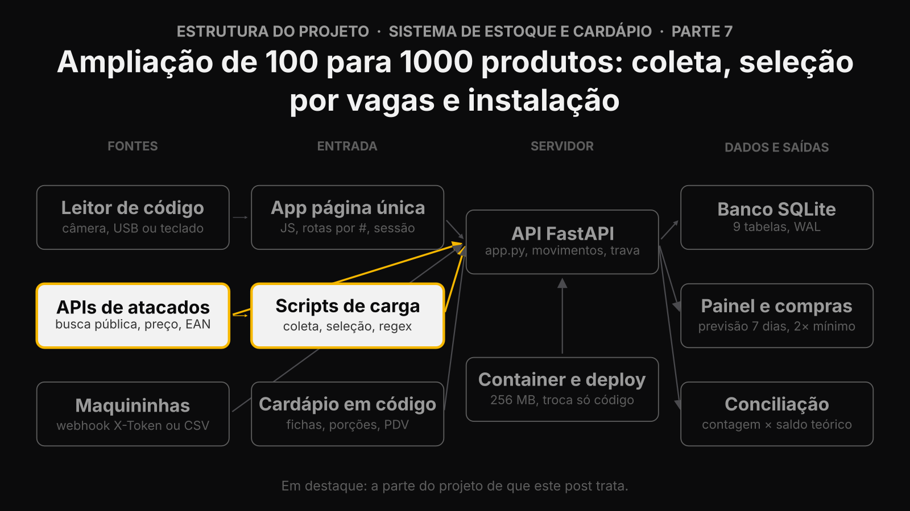

# Ampliação de 100 para 1000 produtos: coleta, seleção por vagas e instalação

**Projeto:** Sistema de estoque e cardápio · **Data:** 23/11/2026 · **Série:** parte 7

*Onde este post fica na estrutura do projeto:*

O sistema de estoque e cardápio que estou fazendo para uma lanchonete é uma aplicação web com banco SQLite. Ele tem bipagem por câmera ou leitor de código de barras, contagem, ficha técnica, vendas e conciliação. Começou com 100 produtos cadastrados à mão. Isso bastava para as telas, mas a bipagem só serve se o código lido existir no cadastro, e com 100 itens a maior parte do que vem do atacado cairia no fluxo de código desconhecido. Ampliei para 1000 produtos com 900 itens do Atacadão e do Tenda Atacado, usando três scripts. `ferramentas/ampliar-coleta.py` traz nome, preço de cada loja, código de barras, foto e a categoria da loja. `ferramentas/ampliar-selecao.py` decide o que entra, sem passar do número de vagas de cada categoria interna definido na constante `VAGAS`. Por último, `ferramentas/ampliar-instalar.py` roda os subcomandos `fotos`, `pacote` e `enviar`, nessa ordem.\
Não classifiquei os 900 itens à mão: a categoria interna é derivada da categoria que o site da loja dá ao produto. A seleção exclui kits, fardos, itens de bebê, pet e higiene pessoal e o que já existia no cadastro, para não duplicar os 100 originais, que já tinham ficha, mínimo e local. Os novos ficaram assim: 200 em Mercearia, 130 em Não alcoólicos, 120 em Destilados, 100 em Descartáveis e limpeza, 90 em Laticínios e frios, 80 em Cervejas, 80 em Vinhos, 60 em Carnes e 40 em Hortifrúti. Com os antigos, a conta fecha em $100 + 900 = 1000$. O código de barras cobriu $856/900 \approx 95{,}1\%$ dos novos. Nos produtos por kg, o código só é gravado quando a embalagem traz o peso no nome, e é isso que explica os 44 sem código. As fotos cobriram $899/900 \approx 99{,}9\%$, e cada uma passou pelo Kaspersky antes de entrar. Antes da instalação, copiei o banco do servidor para um arquivo com data e hora no nome, para poder voltar se algo desse errado.\
Ficaram pendências. O estoque mínimo e o local de guarda vieram de regras por categoria (congelado vai para o Freezer, por exemplo), e os itens mais usados precisam de revisão manual. Muitos itens têm preço de uma loja só e estão marcados para conferência. O Assaí não entrou porque não publica catálogo legível. Além disso, um produto mal classificado no site cai na categoria errada aqui também. E o banco ainda começa com saldo zero até a primeira contagem real. Para refazer com outra distribuição, ajusto `VAGAS` e rodo de novo a seleção e os três subcomandos, sem refazer a coleta.

---
`#Python` `#DataPipeline` `#SQLite` `#ControleDeEstoque` `#Automacao`
