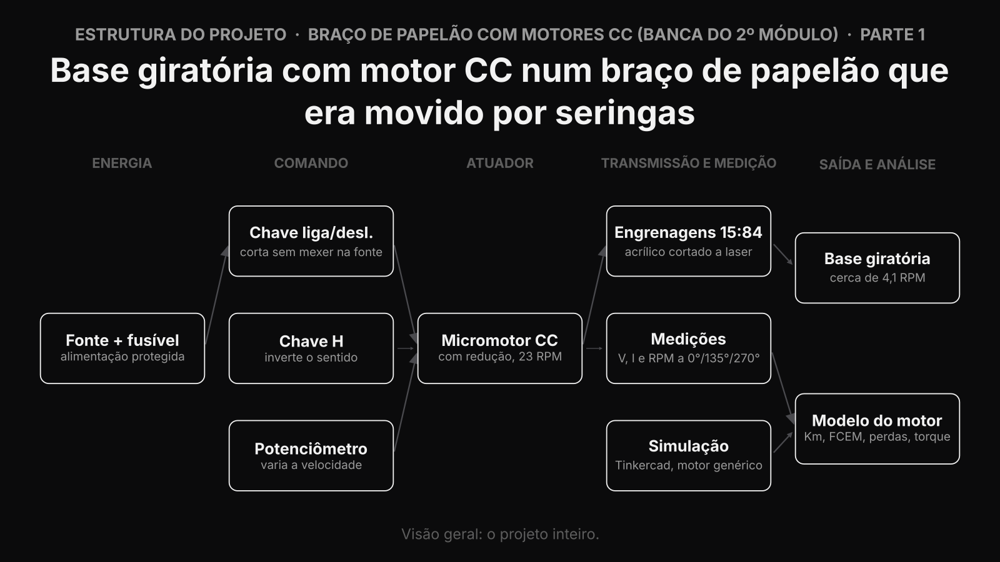

# Base giratória com motor CC num braço de papelão que era movido por seringas

**Projeto:** Braço de papelão com motores CC (banca do 2º módulo) · **Data:** 24/11/2026 · **Série:** parte 1

*Onde este post fica na estrutura do projeto:*

Projeto do meu grupo no 2º módulo de Engenharia de Sistemas Ciber-Físicos (PUC-SP). Começamos com um braço de papelão, MDF e palitos que era acionado por seringas, e a tarefa do módulo era passar o controle das partes móveis para energia elétrica. Decidimos motorizar só a base, com um micromotor CC com redução. O circuito, montado em protoboard, recebe 9 V CC por um módulo com jack fêmea e passa por um fusível de vidro de 250 V / 0,5 A e por uma chave de alavanca simples de liga/desliga. Para inverter o sentido usamos uma chave de alavanca de 6 terminais e 2 posições com jumpers soldados em X. Os terminais centrais vão ao motor, e cada posição liga esses terminais à fonte com polaridade oposta. O motor recebe +/− numa posição e −/+ na outra, o que dá uma ponte H com contatos mecânicos, sem transistores.\
A velocidade é ajustada por um potenciômetro de 1 kΩ em paralelo com um resistor de 470 Ω, com o conjunto em série com o motor. Sozinho, o potenciômetro chegaria a 1 kΩ e deixaria o motor parado. Com o paralelo, pela fórmula de livro, o máximo fica em $R_{eq} = 1/(1/1000 + 1/470) \approx 319{,}73\ \Omega$, e no outro extremo medimos cerca de 3 Ω. O eixo do motor, colado num furo no topo da caixa, entra na EM, de 15 dentes, que engrena na EB, de 84. As duas são de dentes retos e módulo 1, com diâmetros primitivos de 15 e 84 mm e externos de 17 e 86 mm. A redução do par é $i = z_{EB}/z_{EM} = 84/15 = 5{,}6$, somada à interna do micromotor. Cortamos as duas a laser em acrílico, porque as do kit não serviam para esse arranjo. Como o eixo do motor tem um rebaixo, a EM tem furo de 3 mm com meio milímetro achatado num lado. A EB é maior que a base do braço, para a base não encostar no eixo do motor. O furo central dela, de 21,50 mm, recebe um rolamento apoiado num pino de madeira que raspamos até encaixar.\
A base gira 360° nos dois sentidos. O projeto das engrenagens mirava cerca de 0,48 rad/s (4,64 RPM), e no protótipo registramos cerca de 0,43 rad/s. Ficaram três problemas. Girando por muito tempo, a EM e a EB às vezes perdem contato, e piora quando a EB não está bem encaixada. A causa é o motor só colado na caixa, então o mais direto é fixá-lo de forma rígida. Invertendo o sentido várias vezes com o potenciômetro perto do máximo, o motor tende a parar. Uma saída possível é rever a faixa de resistência. Além disso, o braço não fica em pé sozinho, e o peso faz peças como a EB penderem. Para a próxima versão, a ideia é trabalhar o centro de gravidade e reduzir a massa.

---
`#MotorCC` `#Eletronica` `#EngenhariaMecanica` `#Prototipagem` `#SistemasCiberFisicos`
