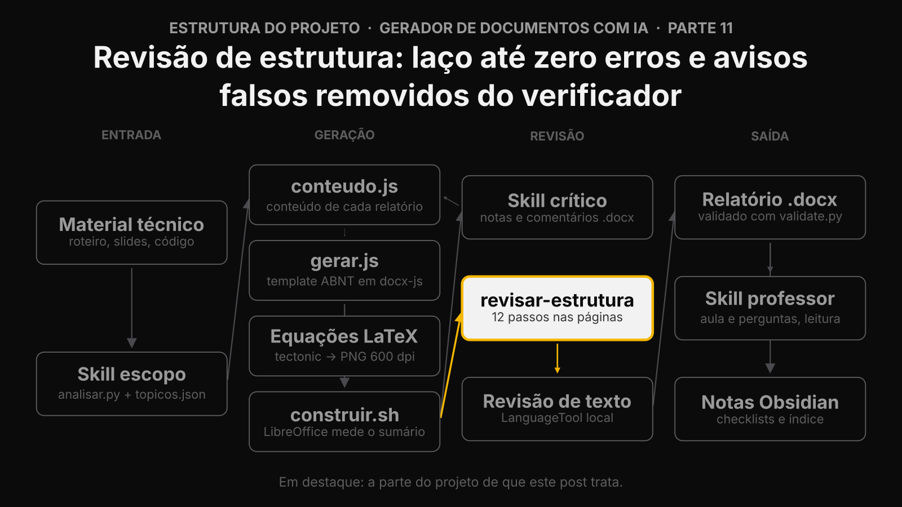

# Revisão de estrutura: laço até zero erros e avisos falsos removidos do verificador

**Projeto:** Gerador de documentos com IA · **Data:** 25/11/2026 · **Série:** parte 11

*Onde este post fica na estrutura do projeto:*

A skill `revisar-estrutura` do meu gerador de relatórios ABNT não termina quando a verificação roda. Ela termina quando o documento renderizado satisfaz $N_{\text{erro}} = 0 \land \forall w \in W_{\text{aviso}}: w$ tem justificativa. O gerador é um conjunto de skills do Claude Code. O conteúdo de cada relatório fica em `conteudo.js`, e o `construir.sh` gera o .docx com docx-js, acerta o sumário pelo LibreOffice, valida e roda as revisões. Cada uma das 5 rodadas do ciclo segue esta ordem: crítico, `relatorio-abnt` aplicando o parecer, `revisar-estrutura` e revisão de texto. A estrutura vem depois do conteúdo porque mudar o texto mexe nas quebras de página, e uma revisão feita antes ficaria desatualizada na mesma rodada.\
O laço renderiza as páginas (no LibreOffice, se não vier PDF), roda `scripts/revisar.sh` e `scripts/estrutura.py` e marca nas imagens vermelho para ❌ e laranja para ⚠️. Para cada marca, o modelo abre a página, decide se o problema é real, corrige no `conteudo.js` e reconstrói. Como nada é editado à mão no .docx, a próxima construção reproduz a correção. A etapa de olhar a imagem existe porque regras como título sozinho no fim da página, legenda separada da figura ou tabela cortada acertam na maioria dos casos e erram em alguns, e uma marcação falsa não pode virar mudança no texto. O aviso não precisa zerar: se é legítimo mas não tem correção que valha a pena, fica registrado com o motivo. A saída é o `revisao-estrutura.md`, as páginas marcadas, uma tabela por passo e a linha da rodada terminando em `estrutura: ❌ 0, ⚠️ k`, com $k$ avisos mantidos.\
Como cada aviso falso custa uma iteração, numa rodada de ajustes mudei três coisas no verificador. A sequência de figuras e tabelas passou a ser conferida só nas páginas do texto. A posição da legenda passou a ser procurada depois das listas pré-textuais, o que eliminou avisos falsos. Pela NBR 14724 essas listas repetem cada legenda com o número da página, então não servem para checar ordem nem posição no corpo. Também passei a aceitar legendas `Código N`, que entraram no mesmo dia em que o `relatorio-abnt` ganhou blocos de código com remissão `@cod:` e fora do corretor de texto. Sem isso a checagem não reconheceria a legenda. Ainda ficaram limitações. Nas quebras muito justas, confiro 2 ou 3 páginas no Word, porque a paginação vem do LibreOffice. O gerador não escreve (continua) em tabela longa: ele a divide em duas, e o verificador segue cobrando a tabela cortada. Além disso, aviso justificado não é aviso resolvido, e um tipo que aparece justificado em todo relatório indica outra regra marcando errado.

---
`#ClaudeCode` `#AIAgents` `#DocumentAutomation` `#ABNT` `#Python`
