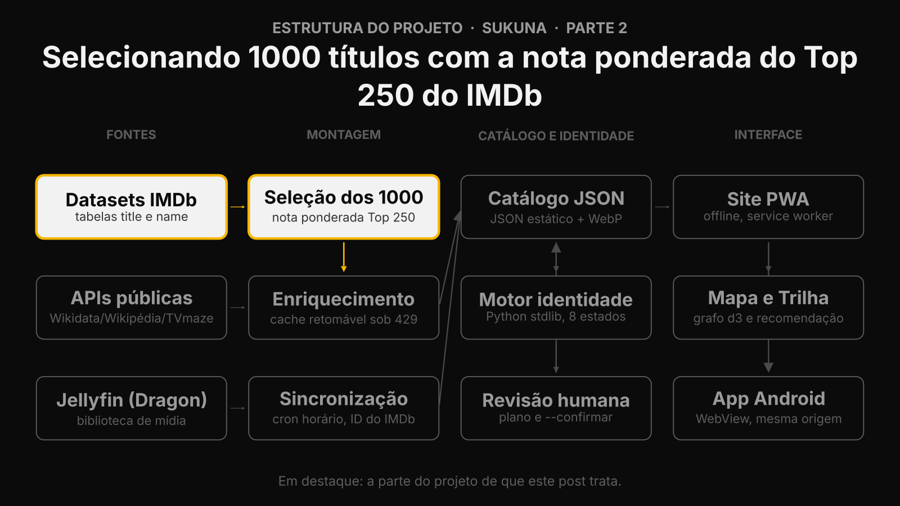

# Selecionando 1000 títulos com a nota ponderada do Top 250 do IMDb

**Projeto:** Sukuna · **Data:** 26/11/2026 · **Série:** parte 2

*Onde este post fica na estrutura do projeto:*

O Sukuna é meu catálogo pessoal de 1000 títulos, 650 filmes e 350 séries, e a primeira etapa do pipeline é escolher quais entram. Começou com os 51 filmes do Sight and Sound 2022, do BFI. Depois vieram as 50 séries de The 100 Greatest TV Shows of All Time (Rolling Stone, 2022). Para chegar a 1000 sem escolher um por um, precisei de um critério reproduzível. As duas listas curadas entram inteiras e o ranking só completa o resto: 599 filmes e 300 séries, 899 no total. O `Ferramentas/selecionar-1000.py` recebe uma pasta com quatro arquivos dos datasets públicos do IMDb (`title.basics`, `title.ratings`, `title.crew` e `name.basics`, em .tsv.gz, ligados por `tconst` e `nconst`) e grava `dados/selecao.json`. Ainda tem a lista `FORCAR` no próprio script, com Jujutsu Kaisen, Jujutsu Kaisen 0, Bleach e clássicos brasileiros, que entram independentemente da posição no ranking.\
O ranking usa a nota ponderada do Top 250 e não a média simples. Na forma clássica publicada pelo IMDb, ela é uma média bayesiana, $WR = \frac{v}{v+m}R + \frac{m}{v+m}C$. Nela $R$ é a nota média do título (`averageRating`), $v$ o número de votos (`numVotes`), $m$ o mínimo de votos usado como peso e $C$ a média de todos os títulos considerados. Os pesos somam 1, então $WR$ fica sempre entre $R$ e $C$. Com $v \ll m$ o título é puxado para a média geral, e com $v \gg m$ temos $WR \to R$. Aí uma nota 9,5 com poucas dezenas de votos não passa na frente de um 8,6 com centenas de milhares. Os valores de $m$ e $C$ do script não estão na nota do projeto. A nota em si fica num passo separado: `python3 Ferramentas/notas-imdb.py <pasta>` relê os datasets e grava nota e votos em `dados/notas-imdb.json`. A interface usa esse arquivo nos graus de maldição, com 特級 Grau Especial a partir de 8,5 e 一級 a partir de 8,0.\
A seleção trabalha só com os arquivos baixados, na mesma linha do resto do projeto. As páginas do IMDb respondem HTTP 202 para clientes automáticos, e o motor de identidade marca esses links como `blocked`, sem tratar como divergência. Ficaram algumas limitações. A seleção é um retrato dos datasets no dia do download. Para mudar quem está no ranking é preciso baixar de novo e rodar `selecionar-1000.py`, porque o `notas-imdb.py` só atualiza quem já está no catálogo. A `FORCAR` também fica no código, editada à mão, e não num arquivo de configuração. E a seleção não confere se cada registro é a obra certa. Isso ficou para o motor de identidade, que depois achou 9 títulos com o texto genérico "título", corrigidos e fixados pelo IMDb em `ajustar-novos.py`.

---
`#Python` `#DataEngineering` `#IMDb` `#Ranking` `#BayesianAverage`
