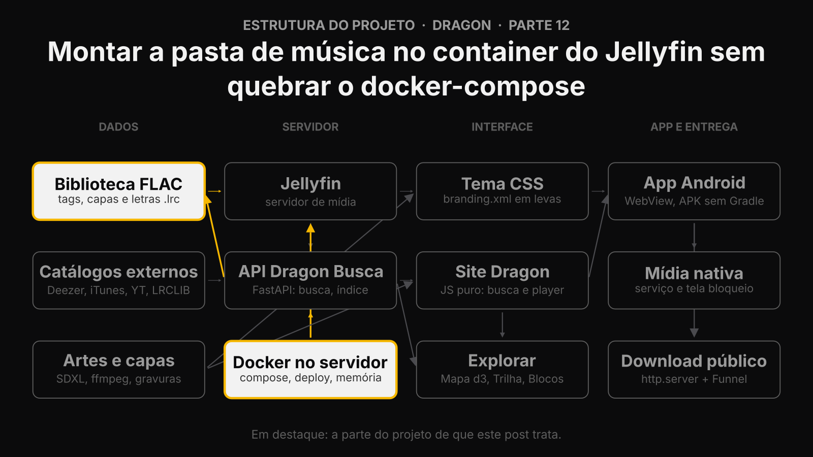

# Montar a pasta de música no container do Jellyfin sem quebrar o docker-compose

**Projeto:** Dragon · **Data:** 27/11/2026 · **Série:** parte 12

*Onde este post fica na estrutura do projeto:*

O Jellyfin que serve o Dragon, meu app de música, roda num container instalado pelo CasaOS que só tinha volumes de filmes e séries. As músicas ficam no servidor em `/DATA/Media/Music`, no formato `Artista/Álbum/faixa.flac`, e para o container essa pasta não existia. No começo a biblioteca Música funcionou com uma cópia provisória em `/config/musica-temporaria`, dentro do volume de configuração que o container já via. O problema é que isso duplicava os arquivos, e a pasta real não recebia nada do que entrava na biblioteca. Aí escrevi o `~/montar-musica.sh`, que liga `/DATA/Media/Music` ao container como `/data/music` com um bind mount somente leitura, o equivalente a `/DATA/Media/Music:/data/music:ro` no Compose. A primeira versão editou o `docker-compose.yml` e cortou o bloco do `tvshows`, o volume das séries, e o arquivo deixou de ser um compose válido. Como YAML depende de indentação e da posição de cada item na lista de volumes, editar esse texto por script sem validar depois deixa espaço para um bloco vizinho sumir. Não reconstruí a linha exata que causou o corte, só registrei o efeito.\
Na segunda versão o script parte sempre do backup fixo `docker-compose.yml.bak-2026-11-04`, e não do arquivo atual, então rodar de novo depois de uma tentativa ruim não acumula estrago. O resultado passa por `docker compose config`, que lê o arquivo, resolve variáveis e interpolações e imprime o modelo final; se o YAML ou o modelo estiver inválido, o comando sai com erro, e o script usa isso como portão antes de mexer no container. Como o compose fica num diretório de sistema do CasaOS, o script roda como root: ou adiciono o volume pela interface (app Jellyfin, Volumes), ou rodo `ssh -t` seguido de `sudo ~/montar-musica.sh`, já que o `-t` aloca um terminal para o `sudo` pedir a senha. Essa versão já foi usada e a pasta está montada.\
Na migração, troquei o caminho da biblioteca Música para `/data/music`, copiei as letras `.lrc` da cópia provisória para `/DATA/Media/Music` pelo lado do servidor, porque de dentro do container a montagem `ro` não deixa gravar, e só depois apaguei `/config/musica-temporaria`. Ficaram limitações. Se o CasaOS regravar o compose, a montagem precisa ser conferida de novo. Se o compose mudar por outro motivo, o backup de data fixa tem que ser renovado antes de rodar o script, senão a mudança se perde. E a validação pega erro de sintaxe e de modelo, mas não um compose válido que perdeu um volume, então conferir o `tvshows` na saída do `docker compose config` ainda é manual.

---
`#Docker` `#DockerCompose` `#Jellyfin` `#SelfHosted` `#Linux`
